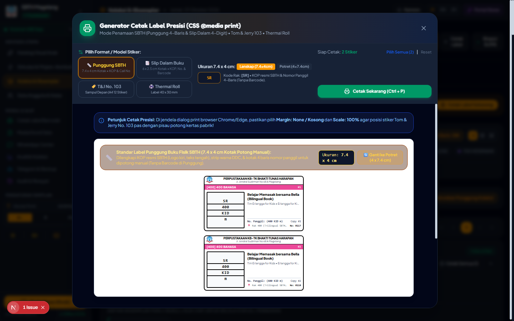
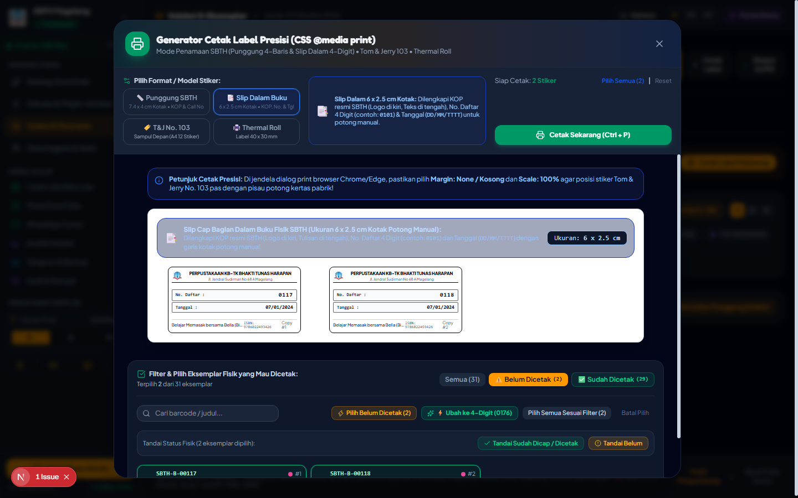
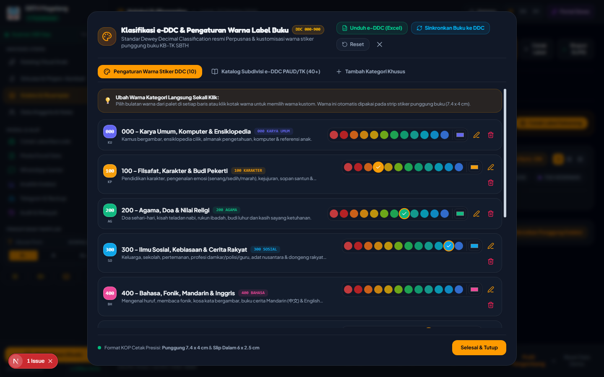
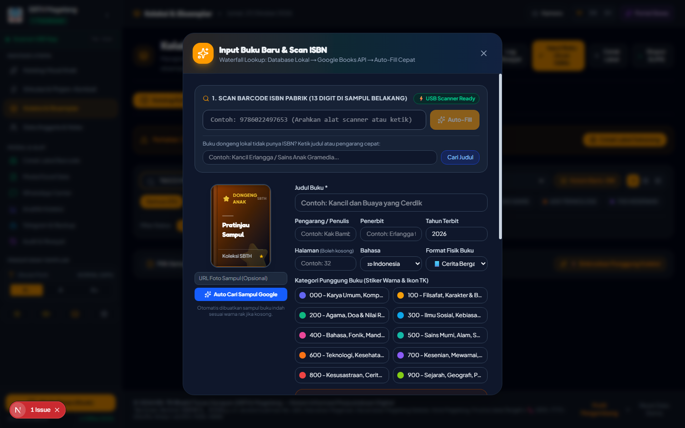
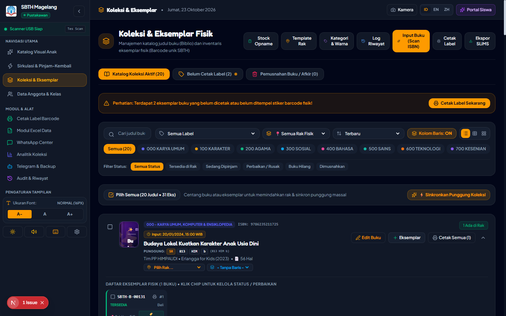
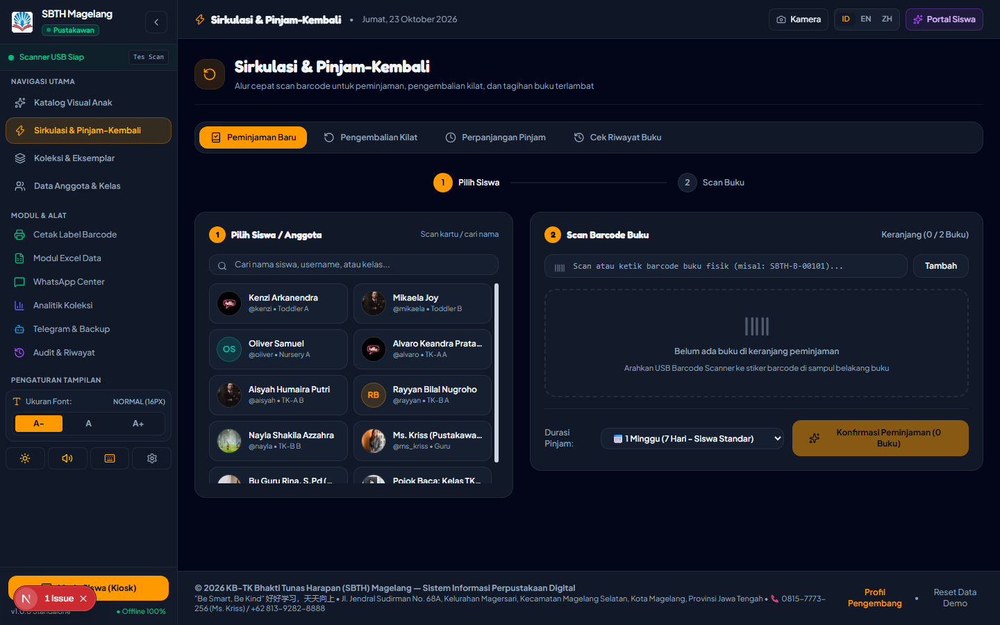
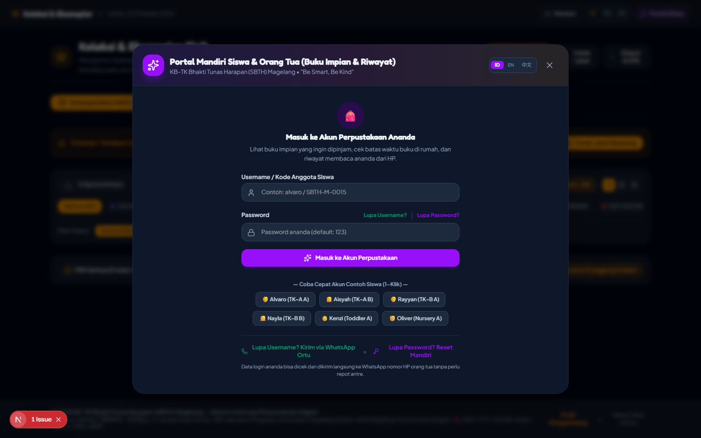

# 📚 Sistem Manajemen Perpustakaan Digital KB-TK Bhakti Tunas Harapan (SBTH)

<div align="center">


### **Aplikasi Perpustakaan Sekolah Modern Standar SLiMS 9 Bulian & Klasifikasi e-DDC Perpusnas RI**
*"Be Smart, Be Kind"* • 好好学习，天天向上  
**KB-TK Bhakti Tunas Harapan — Jl. Jendral Sudirman No 68 A, Magelang**

[](https://nextjs.org/)
[](https://react.dev/)
[](https://www.typescriptlang.org/)
[](https://tailwindcss.com/)
[](https://sqlite.org/)
[]()
[]()
[](https://slims.web.id/)
[](https://perpusnas.go.id/)

> 📖 **Dokumentasi Teknis Lengkap:** [Cetak Biru Arsitektur & Keamanan Sistem](docs/ARCHITECTURE_AND_SECURITY.md)  
> 💼 **Portfolio Showcase:** [Smart Library Management System](https://github.com/prasetyohk/smart-library-management-system)

</div>

---

## 📸 Galeri Tampilan Antarmuka & Fitur Unggulan

### 1. 🌟 OPAC Kiosk Visual Anak (Trilingual ID/EN/ZH)
Katalog pencarian buku visual ramah anak usia dini (PAUD/TK) dengan ilustrasi ceria, filter kategori interaktif, dan pencarian instan.


---

### 2. 🏷️ Generator Cetak Label Punggung Presisi (7.4 x 4 cm Kotak Potong Manual)
Sistem cetak label punggung buku fisik presisi tinggi dengan garis potong manual tegas (`1pt solid black`), **KOP Resmi SBTH (Logo di pojok kiri, Tulisan di tengah)**, strip warna DDC, nomor panggil 4-baris vertikal (`[KODE RAK] / [DDC] / [PENGARANG] / [JUDUL]`), dan info buku lengkap tanpa barcode agar rapi dan fokus pada penataan rak.


---

### 3. 📑 Slip Cap Bagian Dalam Buku Fisik (6 x 2.5 cm Kotak Potong Manual)
Label khusus halaman dalam buku untuk mencatat No. Daftar 4-digit (misal: `0143`), Tanggal Masuk (`DD/MM/YYYY`), dan **Barcode Scanner Vector Code-128 dari nomor daftar 4-digit** untuk pemindaian sirkulasi kilat, dilengkapi KOP resmi sekolah dan garis kotak potong rapi.


---

### 4. 🎨 Klasifikasi e-DDC & Pengaturan Warna Stiker Instan (1-Click Color Change)
Manajemen 10 Kelas Utama DDC (000 s/d 900) dengan fitur ganti warna stiker instan dari 16 palet kurasi sekolah, tombol unduh skema resmi e-DDC ke file Excel (`.xlsx`), dan tombol sinkronisasi buku lama ke format DDC.


---

### 5. ⚡ Input Buku & Scan ISBN Cerdas (Auto-Matching DDC)
Waterfall Lookup (Database Lokal ➔ Google Books API ➔ OpenLibrary). Sistem mendeteksi kata kunci judul/penerbit secara otomatis dan memetakan buku ke kategori DDC dan kode rak tanpa perlu pustakawan mencari manual.


---

### 6. 📚 Manajemen Katalog & Inventaris Eksemplar Fisik (Biblio & Copies)
Tampilan koleksi buku lengkap dengan filter kategori DDC, status cetak label, filter rusak/afkir, ekspor CSV SLiMS 9, dan pencarian multi-parameter.


---

### 7. ⚡ Meja Sirkulasi Pustakawan (Peminjaman & Pengembalian Kilat)
Transaksi sirkulasi super cepat dengan pemindai barcode USB. Mendukung peminjaman mandiri, pengembalian buku, denda otomatis, dan penerbitan slip sirkulasi.


---

### 8. 🎈 Portal Siswa Mandiri & Buku Impianku
Portal interaktif khusus siswa untuk melihat buku yang sedang dipinjam, histori membaca, serta menandai "Buku Impian" yang ingin dibaca selanjutnya.


---

## 🎯 Spesifikasi & Fitur Lengkap Sistem

### 📐 1. Format Cetak Label Presisi SBTH
- **Label Punggung Buku (7.4 x 4 cm)**:
  - Format kotak presisi untuk dipotong gunting/cutter manual.
  - KOP Resmi SBTH: Logo sekolah di pojok kiri atas, teks instansi di tengah:
    - *Baris 1*: `PERPUSTAKAAN KB-TK BHAKTI TUNAS HARAPAN`
    - *Baris 2*: `Jl. Jendral Sudirman No 68 A Magelang`
  - Strip warna kategori DDC cerah kontras untuk navigasi visual di rak.
  - Kotak Call Number 4-Baris Vertikal: `[KODE RAK]` / `[DDC]` / `[3-HURUF PENGARANG]` / `[1-huruf judul]`.
  - **Fokus Tanpa Barcode**: Punggung buku dirancang bersih khusus penataan rak lemari buku.
  - Pilihan orientasi: Default **Lanskap (7.4 x 4 cm)** dan opsional **Potret (4 x 7.4 cm)**.
- **Slip Cap Dalam Buku (6 x 2.5 cm)**:
  - Format kotak presisi potong manual untuk ditempel di lembar dalam buku.
  - KOP Resmi SBTH (Logo kiri, teks tengah).
  - No. Daftar 4 Digit (contoh: `0101`, `0143`).
  - Tanggal Pengadaan Buku (`DD/MM/YYYY`).
  - **Barcode Scanner Code-128**: Meng-encode nomor daftar 4 digit untuk dipindai scanner USB di meja sirkulasi.
  - Judul buku, nomor ISBN, dan nomor salinan eksemplar.

### 📚 2. Klasifikasi e-DDC Standar Perpusnas RI
- Mengadopsi 10 Kelas Utama Dewey Decimal Classification:
  - **`000`** – Karya Umum, Komputer & Ensiklopedia Cilik
  - **`100`** – Filsafat, Karakter & Budi Pekerti Anak
  - **`200`** – Agama, Doa Sehari-hari & Nilai Religi
  - **`300`** – Ilmu Sosial, Kebiasaan & Cerita Rakyat Nusantara (`398.2`)
  - **`400`** – Bahasa, Fonik, Buku Cerita Mandarin (中文) & English
  - **`500`** – Sains Murni, Alam, Dinosaurus, Satwa & Berhitung
  - **`600`** – Teknologi, Kesehatan Tubuh & Kendaraan
  - **`700`** – Kesenian, Mewarnai, Musik & Olahraga
  - **`800`** – Kesusastraan, Cerita Bergambar & Fabel Sedunia (`813`)
  - **`900`** – Sejarah, Geografi, Tokoh Pahlawan & Peta Dunia
- **Subdivisi e-DDC PAUD/TK**: Memuat 40+ rincian subjek spesifik buku anak.
- **Ekspor Excel Langsung**: Unduh skema resmi e-DDC dalam format `.xlsx` (3 sheet: 10 Kelas DDC, Subdivisi PAUD/TK, dan Panduan Cetak).
- **Auto-Matching Scanner**: Pencocokan otomatis nomor klasifikasi DDC saat barcode ISBN dipindai.
- **1-Click Color Swatches**: Ubah warna stiker kategori seketika dengan 1 klik.
- **Sinkronisasi Koleksi**: 1 tombol untuk menyeragamkan seluruh buku lama ke standar DDC.

### 🏛️ 3. Kompatibilitas SLiMS 9 Bulian
- Format biblio & eksemplar kompatibel dengan sistem Senayan Library Management System (SLiMS).
- Fitur Ekspor CSV SLiMS 1-klik untuk integrasi P2P atau migrasi data perpustakaan.
- Pola barcode eksemplar fleksibel (`SBTH-B-00001`, `B00001`, `DNG-00001`, dll).
- Modul Pemusnahan Buku (*Weeding/Afkir*) lengkap dengan Berita Acara Pemusnahan (BAST) resmi 3 tanda tangan.

### 🚀 4. Sirkulasi Cepat & Keamanan Data
- Mendukung pemindai barcode USB Plug-and-Play dan pemindai kamera perangkat.
- Fitur Kas Denda & QRIS otomatis untuk buku terlambat.
- Audit Trail teratribusi: Setiap perubahan dicatat dengan nama pustakawan aktif.
- Integrasi Backup Otomatis ke Telegram Cloud Bot & WhatsApp Notification Center.

### ⚡ 5. Kenyamanan Navigasi & Paginasi Koleksi Pustakawan
- **Sidebar Sticky Viewport**: Saat halaman di-scroll ke bawah sejauh apapun, sidebar navigasi kiri tetap diam (*pinned/sticky*) pada layar sehingga pustakawan tetap dapat mengakses menu dan tombol fungsi kapan saja tanpa kehilangan posisi.
- **Paginasi Fleksibel (10 / 20 / 50 / 100 Buku per View)**: Mencegah scroll terlalu jauh saat mengelola puluhan atau ratusan judul buku, dilengkapi penomoran halaman cerdas (`1`, `2`, `3`, ..., `N`). Preferensi tersimpan otomatis di browser pustakawan.
- **Dual Pagination Bar (Atas & Bawah)**: Bilah navigasi paginasi tersedia di **bagian atas** dan di **bagian bawah** daftar buku agar pustakawan tidak perlu repot scroll bolak-balik saat berpindah halaman.
- **Floating Button "Kembali ke Atas" (Back to Top)**: Tombol melayang cerdas dengan *smooth scroll* otomatis yang muncul saat halaman digulir ke bawah, memudahkan pustakawan melompat kembali ke navigasi atas seketika.

### 🛡️ 6. Arsitektur Tangguh & Keamanan Server (Production-Grade)
- **Database Lokal PC SQLite (WAL Mode)**:
  - Seluruh data buku, anggota, dan riwayat disimpan di file disk `data/sbth_library.db` (bebas dari risiko terhapus saat cache browser di-clear).
  - Menghilangkan batasan kuota 5-10MB browser dan mencegah antarmuka patah-patah (*UI freeze*) dengan proses penyimpanan asinkron di balik layar.
- **Jaminan Transaksi ACID Sirkulasi**:
  - Alur peminjaman dan pengembalian dieksekusi secara atomik di sisi server (`BEGIN IMMEDIATE TRANSACTION ... COMMIT`). Tidak ada buku yang berstatus dipinjam tanpa riwayat sirkulasi yang sah.
- **Pilihan 2 Mode Deployment Fleksibel**:
  - **Mode 1 (On-Premise Local Server + WiFi)**: 1 unit PC utama di meja sirkulasi bertindak sebagai host server. Laptop guru lain dan tablet murid di jaringan sekolah dapat mengakses database yang sama secara real-time via LAN/Wi-Fi (`http://<IP_KOMPUTER_SERVER>:3000`).
  - **Mode 2 (Cloud / VPS Server 24 Jam)**: Dapat di-deploy ke VPS atau cloud hosting (PostgreSQL/Supabase) agar katalog dan sirkulasi dapat diakses online oleh siswa dan wali murid dari rumah.
- **Otentikasi Kriptografis (PBKDF2 + Salt)**:
  - Seluruh verifikasi dipindahkan ke server dengan hashing PBKDF2 10.000 iterasi + salt acak dan sesi HttpOnly cookie. Kredensial tidak pernah tersimpan telanjang di browser atau terbaca via F12.
- **Fitur Pemulihan Password Mandiri (WhatsApp & Email OTP)**:
  - Pustakawan yang lupa PIN/Password dapat melakukan reset mandiri melalui verifikasi kode OTP 6-digit yang dikirimkan via WhatsApp atau Email resmi.
- **Perlindungan Bot Telegram (.env.local)**:
  - Token bot Telegram dan kunci sensitif diproteksi di `.env.local` server dengan penjaga Anti-Open Relay (terlindungi oleh `.gitignore`).
- **Cetak Biru Arsitektur Lengkap**:
  - Pelajari arsitektur sistem dan panduan teknis pada dokumen [Cetak Biru Arsitektur & Keamanan](docs/ARCHITECTURE_AND_SECURITY.md).

---

## 🛠️ Panduan Menjalankan Aplikasi di Windows

### 1. Menjalankan Server (1-Klik Tanpa CMD Hitam)
Klik ganda file:
```text
Perpustakaan SBTH.exe
atau
BUKA_APLIKASI_PERPUSTAKAAN_SBTH.vbs
```
Aplikasi akan langsung terbuka di browser Anda pada alamat `http://localhost:3000`.

### 2. Memasang Ikon Shortcut di Desktop
Klik ganda file:
```text
PASANG_IKON_DESKTOP.bat
```
Ikon pintasan resmi **Perpustakaan SBTH** akan langsung muncul di layar Desktop komputer.

### 3. Menghentikan Aplikasi
Jika ingin mematikan server setelah jam operasional sekolah selesai:
```text
HENTIKAN_APLIKASI.bat
```

---

## 💻 Panduan Pengembangan (Developer Setup)

```bash
# 1. Clone repositori
git clone https://github.com/prasetyohk/smart-library-management-system.git
cd smart-library-management-system

# 2. Pasang dependensi
npm install

# 3. Konfigurasi Variabel Lingkungan
cp .env.example .env.local

# 4. Jalankan server lokal Next.js
npm run dev

# 5. Buka di browser
# http://localhost:3000
```

---

## 📂 Struktur Berkas Proyek

```text
├── public/                 # Aset statis & logo resmi KB-TK SBTH
├── docs/
│   ├── ARCHITECTURE_AND_SECURITY.md # Cetak biru arsitektur & keamanan enterprise
│   └── screenshots/        # Tangkapan layar resolusi tinggi fitur aplikasi
├── src/
│   ├── app/                # Next.js App Router (layout, page, API routes)
│   │   └── api/            # Server API (auth, recovery, circulation, sync, telegram)
│   ├── components/
│   │   ├── auth/           # PinAuthModal, AdminAuthModal, AdminPasswordRecoveryModal
│   │   ├── books/          # ScanIsbnModal, BookManagement, EditBookModal
│   │   ├── categories/     # CategoryManagementModal (e-DDC & Quick Color Picker)
│   │   ├── labels/         # LabelPrintGenerator (Punggung 7.4x4 cm & Slip 6x2.5 cm)
│   │   ├── circulation/    # CirculationDesk (Peminjaman & Pengembalian)
│   │   ├── portal/         # StudentPortalModal (Kiosk Anak)
│   │   └── analytics/      # AnalyticsModal (Statistik & Nilai Aset)
│   ├── lib/
│   │   ├── server/         # Database SQLite (WAL), PBKDF2 Auth, Session Cookies
│   │   ├── eddc.ts         # 10 Kelas DDC, Subdivisi Perpusnas, Excel Exporter, Auto-Matcher
│   │   ├── constants.ts    # Standar nomor panggil SBTH & opsi format buku
│   │   ├── storage.ts      # Client state engine & sync bridge
│   │   └── i18n.ts         # Kamus trilingual (Indonesia, English, Mandarin)
│   └── types/              # Definisi interface TypeScript
└── README.md               # Dokumentasi utama proyek
```

---

## 👨‍💻 Profil Pengembang & Kontak Kolaborasi

Aplikasi dan sistem perpustakaan modern ini dirancang serta dikembangkan oleh:

- **Nama Pengembang:** **Prasetyo H.K.**
- **GitHub:** [@prasetyohk](https://github.com/prasetyohk)
- **X (Twitter):** [@prasetyohk](https://x.com/prasetyohk)
- **Email:** [handy.paynet@gmail.com](mailto:handy.paynet@gmail.com)

> 💼 **Terbuka untuk Kerja Sama:**  
> Menerima jasa pembuatan sistem manajemen perpustakaan sekolah/kampus, sistem informasi kasir/apotek/retail, kustomisasi SLiMS, migrasi database lokal ke cloud, serta pembuatan aplikasi web & desktop kustom berstandar enterprise. Hubungi via Email atau direct message di X!

---

## 📄 Lisensi & Hak Cipta

Dilisensikan di bawah [MIT License](LICENSE).  
Hak Cipta Desain Khusus © **KB-TK Bhakti Tunas Harapan (SBTH) Magelang**.

