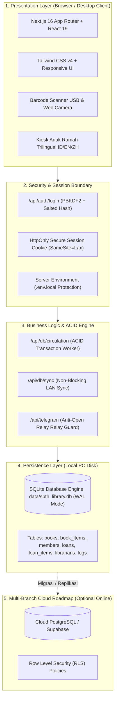

# 🛡️ Cetak Biru Arsitektur & Keamanan Sistem Perpustakaan Modern
### Dari Prototipe "Vibe Coding" Menuju "Production-Grade System"
**KB-TK Bhakti Tunas Harapan (SBTH) • Magelang**

---

## 📌 1. Latar Belakang & Analisis Masalah ("The Vibe Coding Problem")

Tren pengembangan aplikasi berbasis AI (*vibe coding*) sering kali memukau pengguna dengan tampilan antarmuka (UI/UX) yang modern dan fitur visual yang interaktif. Namun, ketika diaplikasikan tanpa pemahaman arsitektur sistem (*system design*) dan algoritma yang matang, aplikasi tersebut rentan mengalami kegagalan fatal pada lingkungan produksi:

| Karakteristik Vibe Coding Instan | Bahaya di Lingkungan Produksi | Solusi Arsitektur Baru SBTH |
| :--- | :--- | :--- |
| **Penyimpanan murni di `localStorage` Browser** | Kuota browser sangat terbatas (5MB - 10MB). Pembersihan cache browser (*Clear History*) menghapus seluruh data perpustakaan seketika. | **Native SQLite Engine (WAL Mode)** di disk PC lokal (`data/sbth_library.db`), tahan jutaan data tanpa limit browser. |
| **Main Thread Blocking (UI Freeze)** | Operasi JSON serialisasi array buku besar pada thread utama menyebabkan animasi patah-patah (*jank*). | **Asynchronous Background Persistence** & non-blocking server API routes. |
| **Data Terisolasi (Multi-Silo Problem)** | Data di laptop guru A tidak pernah sinkron dengan laptop guru B karena masing-masing menyimpan di browser lokal sendiri. | **Centralized LAN Server Sync**; seluruh perangkat di jaringan sekolah mengakses satu database SQLite terpusat secara real-time. |
| **Client-Side Auth & Hardcoded PIN** | PIN tersimpan teks telanjang (*plaintext*) di `localStorage` (terbaca via F12). Adanya celah bypass PIN master (`1234`, `sbth2026`). | **Server-Side Cryptographic Hash (PBKDF2 + Salt)** dan **HttpOnly Session Cookie**. Kredensial tidak pernah terekspos di browser. |
| **Telegram API Open Relay** | `botToken` dan `chatId` dikirim dari browser, endpoint `/api/telegram` dapat disalahgunakan pihak luar untuk spamming. | **Token disimpan di `.env.local` server**, endpoint diproteksi validasi sesi pustakawan resmi. |
| **Ketiadaan Transaksi Database (No ACID)** | Status buku berubah tapi riwayat sirkulasi gagal dibuat saat koneksi/baterai putus, menyebabkan data korup. | **Atomic ACID Transactions** (`BEGIN IMMEDIATE TRANSACTION ... COMMIT`) pada sirkulasi pinjam dan kembali. |

---

## 🏛️ 2. Topologi Arsitektur Sistem Baru



---

## 🔒 3. Implementasi Keamanan Tingkat Server (Security Hardening)

### A. Otentikasi Pustakawan & Hashing Kriptografis
- **Algoritma:** PBKDF2 (*Password-Based Key Derivation Function 2*) menggunakan modul standar `node:crypto`.
- **Pengacakan Salt:** Setiap password/PIN diberi salt acak unik 16-byte (`crypto.randomBytes(16)`).
- **Perbandingan Waktu Aman:** Validasi hash menggunakan `crypto.timingSafeEqual` untuk mencegah serangan *timing attack*.
- **Perlindungan F12 Application:** Atribut `pin` secara otomatis dibersihkan (*sanitized*) sebelum disimpan di memori klien. Siapa pun yang membuka Developer Tools (F12) tidak akan menemukan password atau PIN dalam bentuk teks biasa.

### B. Proteksi Endpoint Telegram & Rahasia `.env.local`
- Token Telegram Bot dan Chat ID disimpan eksklusif pada variabel lingkungan server (`.env.local`):
  ```env
  TELEGRAM_BOT_TOKEN=123456789:ABCDefGhIJKlmNoPQRsTUVwxyZ
  TELEGRAM_CHAT_ID=-1001234567890
  SESSION_SECRET=sbth-library-production-secure-auth-secret-key-2026
  ```
- Endpoint `/api/telegram` memeriksa apakah permintaan berasal dari sesi pustakawan terverifikasi atau dari `localhost`. Permintaan asing dari luar jaringan akan ditolak secara otomatis (*HTTP 401 Unauthorized*).

---

## 💾 4. Integritas Data & Transaksi ACID (Circulation Engine)

Operasi sirkulasi perpustakaan (peminjaman dan pengembalian) dijalankan dalam satu blok transaksi atomik pada SQLite di file `src/lib/server/db.ts`:

### Siklus Peminjaman Atomik (Borrow Transaction):
1. **Validasi Kuota Anggota:** Memeriksa apakah jumlah buku aktif yang dipinjam belum melebihi `maxLoanLimit`.
2. **Kunci Eksemplar:** Memastikan seluruh barcode buku berstatus `AVAILABLE`. Jika salah satu sedang dipinjam atau rusak, transaksi dibatalkan seketika (*Rollback*).
3. **Pencatatan Master Pinjaman:** Membuat baris baru pada tabel `loans`.
4. **Pencatatan Item Pinjaman:** Membuat baris pada tabel `loan_items`.
5. **Pembaruan Inventaris:** Mengubah status eksemplar pada `book_items` menjadi `BORROWED` dan menaikkan `totalLoanCount` pada tabel `books`.
6. **Audit Trail:** Mencatat log aktivitas pustakawan penanggung jawab.
7. **Commit:** Seluruh perubahan disimpan serentak. Jika terjadi kegagalan sistem pada salah satu langkah di atas, database otomatis kembali ke kondisi semula sebelum transaksi dimulai.

---

## 🌐 5. Solusi Multi-Silo (Sinkronisasi Multi-Device di Sekolah)

Untuk memungkinkan beberapa komputer guru atau tablet siswa mengakses perpustakaan secara bersamaan tanpa data terpisah (*silo*):

1. **Jadikan 1 Komputer sebagai Host Server Perpustakaan:**
   - Jalankan aplikasi di komputer utama perpustakaan:
     ```bash
     npm run dev
     # atau jalankan 'Perpustakaan SBTH.exe'
     ```
   - Cek alamat IP lokal komputer tersebut di Command Prompt (`ipconfig`), misal: `192.168.1.15`.
2. **Akses dari Laptop / Perangkat Lain di Jaringan yang Sama:**
   - Buka browser di laptop guru lain atau tablet murid:
     ```text
     http://192.168.1.15:3000
     ```
   - Seluruh perangkat akan membaca dan menulis ke database SQLite yang sama (`data/sbth_library.db`), menjamin data selalu sinkron secara *real-time*.

---

## ☁️ 6. Panduan Migrasi ke Cloud (PostgreSQL / Supabase dengan RLS)

Jika sekolah ingin membuka perpustakaan untuk diakses online 24 jam oleh wali murid dari rumah melalui server cloud (seperti VPS Ubuntu atau Vercel + Supabase), berikut adalah arsitektur yang direkomendasikan:

### Skema Tabel PostgreSQL & Row Level Security (RLS):

```sql
-- 1. Aktifkan RLS pada seluruh tabel sensitif
ALTER TABLE books ENABLE ROW LEVEL SECURITY;
ALTER TABLE book_items ENABLE ROW LEVEL SECURITY;
ALTER TABLE loans ENABLE ROW LEVEL SECURITY;
ALTER TABLE members ENABLE ROW LEVEL SECURITY;

-- 2. Kebijakan Katalog Buku: Siapa saja (termasuk tamu publik) boleh melihat katalog
CREATE POLICY "Katalog dapat dibaca publik" 
ON books FOR SELECT 
USING (true);

-- 3. Kebijakan Sirkulasi: Siswa hanya boleh melihat riwayat pinjaman miliknya sendiri
CREATE POLICY "Siswa hanya melihat pinjamannya sendiri" 
ON loans FOR SELECT 
USING (auth.uid() = member_user_id);

-- 4. Kebijakan Pustakawan: Pustakawan dan Admin memiliki hak penuh (CRUD)
CREATE POLICY "Pustakawan memiliki akses penuh" 
ON loans FOR ALL 
USING (auth.jwt() ->> 'role' IN ('ADMIN', 'LIBRARIAN'));
```

### Panduan Deployment Cloud:
1. **Frontend + API Routes:** Deploy ke **Vercel** atau VPS Ubuntu dengan reverse proxy **Nginx + PM2**.
2. **Database:** Gunakan layanan PostgreSQL terkelola (**Supabase / Neon / Cloud SQL**).
3. **Environment:** Masukkan `DATABASE_URL` dan `SESSION_SECRET` pada panel environment hosting cloud Anda.
