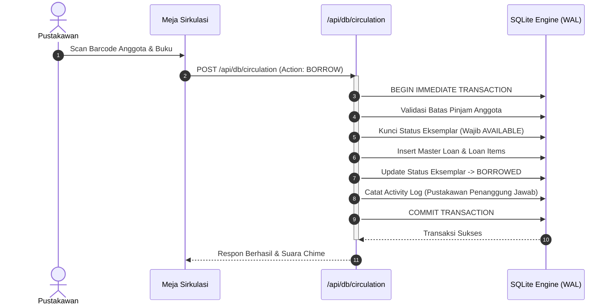

# 🛡️ Cetak Biru Arsitektur & Keamanan Sistem Perpustakaan Modern
### Production-Grade System Architecture & Enterprise Security Specification
**Sistem Manajemen Perpustakaan Terpadu (Smart Library Management System)**

---

## 📌 1. Prinsip Desain & Komparasi Standar Sistem Perpustakaan

Pengembangan aplikasi perpustakaan modern membutuhkan fondasi arsitektur sistem (*system design*) dan algoritma yang tangguh agar mampu menangani sirkulasi buku harian, ribuan katalog eksemplar, dan multi-pengguna secara bersamaan tanpa risiko kehilangan data.

Berikut adalah komparasi antara model penyimpanan sisi klien biasa (*client-side storage*) dengan Arsitektur Standar Industri yang diimplementasikan pada sistem ini:

| Parameter Arsitektur | Keterbatasan Model Sisi Klien Biasa (`localStorage`) | Keunggulan Sistem Produksi (SBTH Production Engine) |
| :--- | :--- | :--- |
| **Penyimpanan Data** | Kuota browser sangat terbatas (5MB - 10MB). Pembersihan cache browser (*Clear History*) menghapus seluruh data perpustakaan seketika. | **Native SQLite Engine (WAL Mode)** di disk PC lokal (`data/sbth_library.db`), sanggup menampung puluhan ribu eksemplar dengan integritas data permanen. |
| **Kinerja Antarmuka** | Operasi JSON serialisasi array buku besar pada thread utama menyebabkan animasi tersendat (*main-thread UI freeze*). | **Asynchronous Background Persistence** & non-blocking Next.js server API routes dengan throughput tinggi. |
| **Akses Multi-Perangkat** | Data di laptop staf A tidak pernah sinkron dengan laptop staf B karena masing-masing terisolasi di browser lokal (*data silo*). | **Centralized Local Network (LAN) Server**; seluruh perangkat di jaringan sekolah mengakses satu database server terpusat secara *real-time*. |
| **Otentikasi & Keamanan** | Kredensial tersimpan dalam bentuk teks biasa (*plaintext*) di browser dan dapat diintip melalui F12 DevTools. Adanya celah bypass hardcoded. | **Server-Side Cryptographic Hash (PBKDF2 + Salt)** dan **HttpOnly Session Cookie**. Kredensial tidak pernah terekspos di browser F12. |
| **Pemulihan Akses** | Jika lupa password, pengguna terkunci total atau harus mengedit kode sumber program secara manual. | **Self-Service Password Reset via WhatsApp & Email OTP** terenkripsi dengan masa kedaluwarsa 15 menit dan validasi atomik di server. |
| **Perlindungan Integrasi API** | Kunci rahasia API (seperti Bot Telegram) dikirim dari browser sehingga rawan disalahgunakan pihak luar (*open relay*). | **Kunci API disimpan eksklusif di `.env.local` server**, endpoint diproteksi otorisasi sesi dan validasi origin jaringan internal. |
| **Integritas Transaksi** | Status buku berubah tetapi riwayat sirkulasi gagal dibuat saat koneksi/baterai putus, menyebabkan inkonsistensi data (*No ACID*). | **Atomic ACID Transactions** (`BEGIN IMMEDIATE TRANSACTION ... COMMIT`) pada seluruh alur sirkulasi peminjaman dan pengembalian. |

---

## 🏛️ 2. Topologi Arsitektur Sistem

Sistem dirancang dengan arsitektur berlapis (*multi-tier architecture*) yang memisahkan antara antarmuka pengguna, lapisan keamanan, logika bisnis, dan basis data:

```mermaid
graph TD
    subgraph ClientLayer ["1. Presentation Layer (Browser / Desktop Client)"]
        UI["Next.js 16 App Router + React 19"]
        Tailwind["Tailwind CSS v4 + Responsive Design System"]
        Scanner["Barcode Scanner USB & Web Camera"]
        OpacKiosk["Kiosk Anak Ramah Trilingual (ID / EN / ZH)"]
        LabelEngine["Generator Cetak Label Presisi (CSS @media print)"]
    end

    subgraph SecurityLayer ["2. Security & Session Boundary"]
        AuthRoute["/api/auth/login (PBKDF2 10.000 Iterasi + Salt)"]
        RecoveryRoute["/api/auth/recovery (WhatsApp & Email OTP Engine)"]
        SessionCookie["HttpOnly Secure Session Cookie (SameSite=Lax)"]
        EnvConfig["Server Environment (.env.local Protection)"]
    end

    subgraph ServiceLayer ["3. Business Logic & ACID Engine"]
        CirculationEngine["/api/db/circulation (ACID Transaction Worker)"]
        SyncEngine["/api/db/sync (Non-Blocking LAN Sync)"]
        TelegramService["/api/telegram (Anti-Open Relay Relay Guard)"]
    end

    subgraph PersistenceLayer ["4. Persistence Layer (Local PC Disk)"]
        SQLiteDB[("SQLite Database Engine: data/sbth_library.db (WAL Mode)")]
        Tables["Tabel: books, book_items, members, loans, loan_items, librarians, password_resets, activity_logs"]
    end

    subgraph CloudRoadmap ["5. Multi-Branch Cloud Roadmap (Online Deployment)"]
        SupabasePostgres[("Cloud PostgreSQL / Supabase")]
        RLSPolicies["Row Level Security (RLS) Policies"]
    end

    ClientLayer --> SecurityLayer
    SecurityLayer --> ServiceLayer
    ServiceLayer --> PersistenceLayer
    PersistenceLayer -.->|Migrasi / Replikasi| CloudRoadmap
```



---

## 🌐 3. Pilihan Mode Deployment (Fleksibilitas Arsitektur)

Sistem dirancang untuk mendukung **2 Mode Deployment Fleksibel** sesuai kebutuhan dan infrastruktur institusi:

### 🏢 Mode 1: On-Premise Local Server (1 PC Server + Multi-Device WiFi / LAN)
*Sangat direkomendasikan untuk sekolah yang mengutamakan kecepatan maksimal, bebas biaya bulanan cloud, dan privasi data 100% di lingkungan internal.*

- **Topologi:** 1 unit Komputer di meja sirkulasi perpustakaan difungsikan sebagai **Host Server Lokal**. Seluruh laptop guru, staf tata usaha, dan tablet siswa di perpustakaan terhubung ke jaringan WiFi/LAN sekolah yang sama.
- **Mekanisme Akses:**
  1. Komputer Host Server menjalankan aplikasi (`npm run dev` atau file `.exe`).
  2. Buka Command Prompt pada komputer server, ketik `ipconfig` untuk melihat IP lokal (misalnya: `192.168.1.50`).
  3. Laptop guru lain atau tablet murid cukup membuka browser dan mengetik alamat:
     ```text
     http://<IP_KOMPUTER_SERVER>:3000
     # Contoh: http://192.168.1.50:3000
     ```
  4. Seluruh transaksi dari semua perangkat langsung tersimpan ke satu database SQLite terpusat (`data/sbth_library.db`) secara *real-time*.

### ☁️ Mode 2: Cloud / VPS Server (Online Multi-Branch & Akses 24 Jam)
*Cocok jika sekolah ingin membuka katalog buku (OPAC) dan layanan pinjaman untuk diakses oleh wali murid dari rumah atau antar cabang sekolah yang berbeda lokasi geografis.*

- **Topologi:** Aplikasi di-deploy ke server Cloud (VPS Ubuntu dengan Docker/PM2 atau Vercel) dan database menggunakan PostgreSQL terkelola (Supabase / Neon).
- **Mekanisme Akses:** Pengguna mengakses melalui domain resmi sekolah bersertifikat SSL (misalnya: `https://perpustakaan.sekolah.sch.id`).

---

## 🔒 4. Keamanan Tingkat Server & Enkripsi Kriptografis

### A. Otentikasi Pustakawan & Hashing Kriptografis
- **Algoritma:** PBKDF2 (*Password-Based Key Derivation Function 2*) menggunakan modul bawaan `node:crypto`.
- **Pengacakan Salt:** Setiap password atau PIN diberi salt acak unik 16-byte (`crypto.randomBytes(16)`).
- **Perlindungan Timing Attack:** Verifikasi hash menggunakan `crypto.timingSafeEqual` untuk mencegah analisa waktu respon.
- **Sanitasi Klien (Anti-F12 Leak):** Atribut password/PIN secara otomatis dibersihkan (*sanitized*) dari state browser. Membuka Developer Tools (F12 Application Local Storage) tidak akan pernah menampilkan kredensial akun dalam bentuk teks biasa.

### B. Proteksi Variabel Lingkungan & Anti-Open Relay
Variabel sensitif disimpan eksklusif pada berkas lingkungan server (`.env.local`) yang **tidak pernah di-commit ke Git**:

```env
# Format Variabel Lingkungan Server (.env.local)
# CATATAN: Kredensial nyata dilindungi oleh .gitignore dan tidak pernah diunggah ke publik.
TELEGRAM_BOT_TOKEN=your_telegram_bot_token_here
TELEGRAM_CHAT_ID=your_telegram_channel_or_group_id_here
SESSION_SECRET=your_random_32_character_session_secret_key_here
```

> [!IMPORTANT]
> Seluruh endpoint sensitif (seperti `/api/telegram`) dilengkapi lapisan penjaga (*authorization guard*) yang memverifikasi bahwa permintaan berasal dari sesi pustakawan resmi atau lingkungan server internal. Akses tidak sah dari pihak luar akan otomatis ditolak dengan kode respon *HTTP 401 Unauthorized*.

### C. Sistem Pemulihan Akses Mandiri (Self-Service Reset via WhatsApp & Email OTP)
Jika pustakawan atau administrator lupa password atau PIN:
1. Pustakawan membuka menu **"Lupa Password"** pada modal autentikasi.
2. Memasukkan username akun dan memilih saluran pengiriman kode verifikasi (**WhatsApp** atau **Email**).
3. Server membuat kode OTP 6-digit acak yang disimpan dalam tabel `password_resets` dengan masa berlaku **15 menit** dan status satu kali pakai (*single-use*).
4. Pustakawan menerima kode OTP resmi, memasukkan kode tersebut bersama password/PIN baru yang diinginkan.
5. Server memvalidasi kode secara atomik, memperbarui hash password dengan salt baru, mencatat kejadian pada *audit log*, dan mengaktifkan kredensial baru seketika.

---

## 💾 5. Integritas Sirkulasi & Transaksi ACID

Operasi sirkulasi perpustakaan (peminjaman dan pengembalian) dijalankan dalam satu blok transaksi atomik pada SQLite (`src/lib/server/db.ts`):



Jika terjadi gangguan daya listrik atau koneksi terputus di tengah proses, database SQLite otomatis melakukan *Rollback* ke kondisi awal, mencegah data korup atau buku hilang tanpa riwayat.

---

## 📋 6. Checklist Persiapan Implementasi (Deployment Readiness)

Untuk institusi sekolah yang ingin mengimplementasikan sistem ini, berikut adalah daftar persiapan perangkat keras dan lunak yang direkomendasikan:

### 🖥️ Kebutuhan Perangkat Keras (Hardware):
1. **1 Unit Komputer Host Server (Meja Sirkulasi):**
   - Prosesor: Minimal Intel Core i3 / AMD Ryzen 3 (atau setara).
   - RAM: Minimal 4 GB (Disarankan 8 GB).
   - Penyimpanan: SSD minimal 128 GB (untuk kecepatan pembacaan database SQLite).
   - Sistem Operasi: Windows 10/11, macOS, atau Linux Ubuntu.
2. **Perangkat Jaringan:**
   - 1 Unit Router Wi-Fi / Switch LAN lokal sekolah.
3. **Perangkat Input & Cetak:**
   - Barcode Scanner USB (1D/2D) Plug-and-Play untuk pemindaian nomor daftar & ISBN.
   - Printer Inkjet / Laser standar (untuk cetak label stiker A4 presisi).

### ⚙️ Kebutuhan Perangkat Lunak (Software):
1. **Runtime:** [Node.js](https://nodejs.org/) versi v20 LTS atau v24 LTS.
2. **Browser:** Google Chrome, Microsoft Edge, atau Mozilla Firefox versi terbaru.
3. **Variabel Lingkungan:** Salin `.env.example` menjadi `.env.local` dan isi kunci sesi acak.

---

## 👨‍💻 Profil Pengembang & Kontak Kolaborasi

Sistem Manajemen Perpustakaan Modern ini dirancang dan dikembangkan dengan standar rekayasa perangkat lunak profesional oleh:

- **Nama Pengembang:** **Prasetyo H.K.**
- **GitHub:** [@prasetyohk](https://github.com/prasetyohk)
- **X (Twitter):** [@prasetyohk](https://x.com/prasetyohk)
- **Email:** [prasetyohandydrops@gmail.com](mailto:prasetyohandydrops@gmail.com)

> 💼 **Layanan & Kerja Sama:**
> Menerima konsultasi arsitektur sistem, pengembangan aplikasi web/desktop khusus sekolah & instansi, kustomisasi standar perpustakaan SLiMS, serta migrasi sistem ke cloud SaaS. Silakan hubungi melalui Email atau DM di platform X.

---
*Dokumentasi ini disusun sebagai standar arsitektur resmi Sistem Manajemen Perpustakaan Terpadu.*

